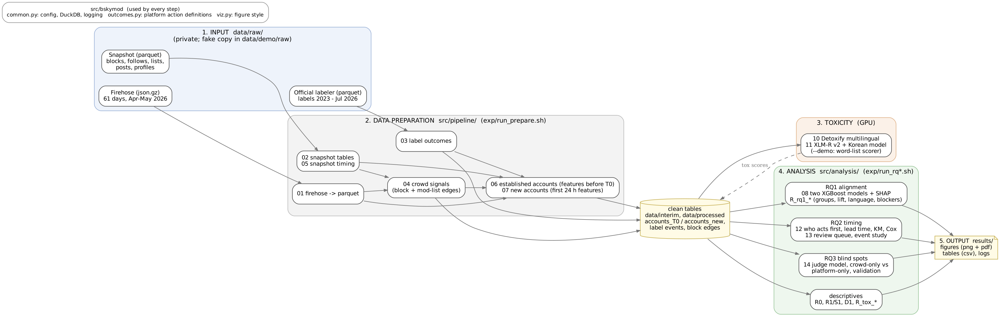

# Crowd vs Platform: community blocking and official moderation on Bluesky

Bluesky has two moderation systems running side by side. The crowd: users block accounts and subscribe to
block lists. The platform: Bluesky's own moderation service labels posts, flags accounts for review,
suspends and takes accounts down. This project measures how the two compare, using a snapshot of the
network, two months of the live event stream (firehose) and the full history of the official labeler.

Research questions

- RQ1 Alignment. Do block bursts (the crowd) and platform actions respond to the same account behaviour?
- RQ2 Timing. When both act on the same account, who acts first and by how much? Could crowd signals
  speed up the platform's review queue?
- RQ3 Blind spots. Which accounts does the crowd flag that the platform never acts on, and the reverse?

The real data is private (shared by collaborators, far too large for git) and is not in this repository. A small fake
dataset in exactly the same format is included so the whole pipeline can be run end to end on a laptop.

## 1. Quick start (demo on fake data, about 2 minutes, no GPU)

    git clone <this repo> && cd bluesky-crowd-vs-platform
    python3 -m venv .venv && source .venv/bin/activate
    pip install -r requirements.txt
    bash exp/demo/run_demo.sh

This runs every step of the real pipeline on it and writes all
figures and tables to `exp/demo/results/` (log: `exp/demo/demo_run.log`). The only difference from the real
run is that the GPU toxicity models are replaced by a word-list scorer (`--demo`), see section 5.

## 2. Architecture

The pipeline has four blocks. Every step is one script that reads files and writes files, so each step can
be checked on its own (row counts go to `results/logs/`).

1. Input: three raw sources (snapshot, firehose, labeler).
2. Data preparation (`src/pipeline/00-07`): parse, clean and join the raw data into per-account tables.
3. Toxicity (`src/pipeline/10-11`): score a sample of posts per account with toxicity models (GPU).
4. Analysis (`src/analysis/`): one block per research question, each writing figures and tables.

## 3. Repository layout

    README.md               this file
    config.yaml             all paths and DuckDB settings for the real run (one place to change them)
    requirements.txt        Python packages (CPU); requirements-gpu.txt adds the toxicity models
    env.sh, setup_server.sh one-time setup on the GPU server (caches, venv, links to raw data)
    docs/
      architecture.png      block diagram above (source: architecture.dot)
      decisions.md          every design decision with date and reason
      walkthrough.md        order in which the code is presented in the review
    src/
      bskymod/              shared library used by every step
        common.py           load config, DuckDB connection (UTC), logging
        outcomes.py         definitions of the platform actions (takedown, review, abuse, adult, ...)
        viz.py              figure style, save figure as png + pdf + csv of the plotted numbers
        demo_scorer.py      word-list toxicity scorer, used only with --demo
      pipeline/             steps 00-07 and 10-11 (data preparation and toxicity)
      analysis/             RQ1, RQ2, RQ3 and descriptive scripts
      demo/make_demo_data.py  fake dataset generator
    data/
      README.md             expected layout of the real data (not included)
      demo/raw/             fake raw data, same format as the real data
    exp/                    experiment runners (one per stage) + demo
      common.sh             shared settings: CONFIG, GPU, DEMO, SEEDS
      run_prepare.sh        stage 1   run_toxicity.sh  stage 2
      run_rq1.sh  run_rq1_robustness.sh  run_rq2.sh  run_rq3.sh
      run_all.sh            all stages in order
      demo/                 config_demo.yaml, run_demo.sh

## 4. Modules: what each step reads and writes

Paths are relative to `data/` (real run) or `exp/demo/work/` (demo). `interim/` = cleaned tables,
`processed/` = one row per account.

| Step | Reads | Does | Writes |
|---|---|---|---|
| 00_inventory | raw/ | schemas, row counts, date ranges, broken files | results/inventory/report.md |
| 01_firehose_to_parquet | raw/firehose/*.json.gz | one pass per day; splits events into tables; salvages truncated files | interim/firehose/{ops,posts,graph,interactions,profiles}/day=*/ |
| 02_snapshot_tables | raw/snapshot/*.parquet | repo_id -> DID join, JSON records -> columns | interim/snapshot/{blocks,follows,lists,listitems,listblocks,profiles,post_history}.parquet |
| 05_snapshot_timing | snapshot at_rev | decodes the repo revision (TID) into the last commit time = crawl time per account | interim/snapshot/repo_rev.parquet, results/S0 |
| 03_label_outcomes | raw/labelers | account labels vs post labels, takedown / suspend / review times, negations (reversals) | interim/labels/ (Apr-Jul 2026), interim/labels_hist/ (2023-2026) |
| 04_crowd_signals | snapshot + firehose graph tables | merges the same block record seen in both sources, removes unblocks, builds block and mod-list edges with times | interim/crowd/{block_edges,listitem_edges,subject_signals,account_activity}.parquet |
| 06_snapshot_features | snapshot tables, crowd, labels | established accounts: behaviour features from data before T0 = 2026-04-09, outcomes after | processed/accounts_T0.parquet |
| 07_new_accounts | firehose, crowd, labels | accounts not in the snapshot: features from the first 24 h after first seen | processed/accounts_new.parquet |
| 10_toxicity | text samples | Detoxify multilingual on up to 5 posts per account (4 GPUs, resumable chunks) | processed/tox_{established,new}.parquet |
| 11_toxicity_multi | same posts | TextDetox XLM-R v2 for most languages, kor_unsmile for Korean | processed/tox2_{established,new}.parquet |
| 08_rq1_models | processed/, labels | two XGBoost models on the same features: B = block burst (5+ new blockers in 30 days), T = platform action; out-of-fold AUC, SHAP, rank correlation of importances | results/RQ1/<tag>/ (F40 SHAP, T40-T42) |
| R_rq1_final / response / language / blockers | RQ1 runs, labels, crowd | four groups (blocked only, removed only, both, neither), lift of each action after a burst, results by language, ordinary vs heavy blockers | results/RQ1/{final,response,language,blockers} |
| 12_rq2_timing | processed/, crowd, labels | crowd alert (5th ordinary blocker) vs first platform action: who first, lead time, Kaplan-Meier, Cox | results/RQ2 (F90-F95) |
| 13_rq2_extra | same | ranking accounts by crowd signal as a review queue, follower bands, event study around takedown | results/RQ2/extra (F96-F99) |
| 14_rq3_blindspots | processed/, tox2, labels | a "judge" model trained on platform outcomes scores crowd-only accounts; validation on later labels; visibility and language blind spots | results/RQ3 (F101-F107) |
| R0, R1 / S1, D1, R_tox_* | labels, crowd, tox | descriptive figures: data coverage, enforcement over time, which actions exist, toxicity by group | results/{R0,R1,S1,RQ1/probe,TOX} |

Main definitions (fixed before modelling, see docs/decisions.md)

- Two populations: established accounts (in the snapshot, index time T0 = 2026-04-09) and new accounts
  (first seen in the firehose, index time = first seen + 24 h; accounts taken down inside those 24 h are
  reported separately because nobody could have predicted them).
- Leakage rule: every feature uses only data before the index time; outcomes are counted after it.
  Blocking features are never inputs to the RQ1 models, because they are the label of model B.
- Block burst: at least 5 new distinct blockers within 30 days (k = 2 and k = 10 as robustness).
- Platform actions come from the official labeler only (src/bskymod/outcomes.py).

## 5. Demo data

`src/demo/make_demo_data.py` writes about 6,000 fake accounts with planted behaviour: trolls (toxic
replies, blocked in bursts, abuse labels mostly when English), spammers (links, duplicates, reviewed and
taken down, rarely blocked), adult accounts, a mostly German group that is blocked a lot but never
labelled, accounts taken down in 2024-2025, and new accounts (half of the new spammers are taken down
within 24 h). The files have the same columns and formats as the real ones (snapshot parquet with JSON
records, firehose json.gz event lines, labeler parquet), so steps 00-14 run unchanged. A fixed seed makes
every run identical.

The numbers in `exp/demo/results/` only show that the code runs and recovers the planted pattern; they are
not research results.

## 6. Running on the real data

    bash setup_server.sh /path/to/downloads      # once: links raw data, creates .venv, caches on the data disk
    source env.sh
    pip install -r requirements-gpu.txt          # toxicity models (after installing torch for your CUDA)
    bash exp/run_prepare.sh                      # several hours
    bash exp/run_toxicity.sh                     # a few hours on 4 GPUs
    bash exp/run_rq1.sh; bash exp/run_rq1_robustness.sh; bash exp/run_rq2.sh; bash exp/run_rq3.sh

Settings: `CONFIG=...` (default config.yaml), `GPU=""` to train on CPU, `SEEDS=5` retrained models per run.
Tools: Python 3.10+, DuckDB (all large joins run as SQL on parquet files), XGBoost, lifelines, matplotlib.
